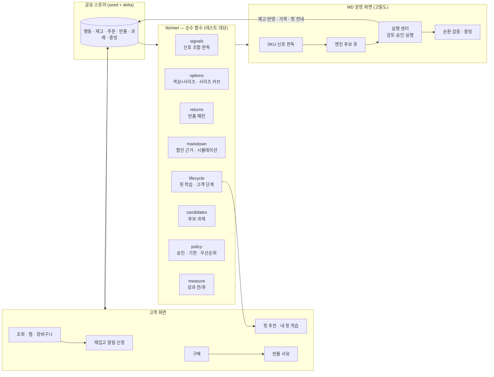

# Commerce Intelligence — 고객 행동을 SKU 운영 판단으로 바꾸는 계층

> 9차 고도화(D-48 ~ D-53). "패션몰 + 관리자"가 아니라, 고객의 조회·찜·장바구니·구매·반품 행동을
> **색상×사이즈 옵션 단위의 운영 판단**으로 바꾸고, 그 판단의 실행·결과를 다시 고객 경험과 증빙으로 닫는 구조.
> 모든 수치는 DEMO 데이터 기준이며, 가정값은 화면과 코드에 함께 적혀 있다(실증에서 보정).

## 1. 한 장 구조

- **엔진은 후보와 근거만 만든다.** 과제 등록·승인·실행은 사람이 한다(L3, 자동발주 없음).
- **계산은 전부 `src/lib/intel/*`의 순수 함수**다. 화면은 결과를 보여주기만 하고, 같은 함수가 단위 테스트와 E2E에서 검증된다.
- 실데이터로 바꿀 때는 `seed`(시드)와 `store`(delta)만 교체한다. 엔진의 입력은 `Variant`·`Order`·`ReturnRequest` 모양 그대로다.

## 2. 엔진별 규칙

### 2.1 신호 판독 `signals.ts`
SKU마다 7일 vs 직전 7일 신호 벡터(조회·찜·장바구니·판매·구매전환·장바구니→구매·반품률·사이즈 사유 비중·남은 판매일·리드타임)를 만들고, **위에서부터 먼저 맞는 규칙 하나**로 판독한다. 손실이 큰 문제부터 본다.

| 순서 | 패턴 | 조건(요약) | 다음 행동 |
|---|---|---|---|
| 1 | 수요 급등 · 재고 부족 | 품절 또는 남은 판매일 ≤ 리드타임 **그리고** 조회↑·찜/장바구니↑·재입고 신청 ≥ 5 중 하나 | 재입고 |
| 2 | 팔리지만 돌아옴 | 반품 ≥ 2건 · 반품률 ≥ 15% · 사이즈/핏 사유 ≥ 60% | 핏 안내 개선 |
| 3 | 관심 ↑ · 구매 ↓ | 조회↑ + 찜/장바구니↑ + 구매전환 −25% 이하. **같은 색 인기 사이즈가 품절이면 '대체 탐색'**으로 읽고 이 옵션이 아니라 품절 사이즈 재입고를 해법으로 제시(심각도 상한 70) | 구매 장벽 점검 / 품절 사이즈 재입고 |
| 4 | 장바구니 이탈 | 장바구니 ≥ 8 · 장바구니→구매 < 25% · 재고 있음 | 장바구니 리마인드 |
| 5 | 관심 식음 · 재고 과잉 | 조회 −20% 이하 · 남은 판매일 ≥ 45일 | 저회전 대응 · 할인 검토 |

- **노이즈 가드**: 조회 30회·찜/장바구니 6건 미만이면 증감률을 신호로 쓰지 않는다(적은 물량의 % 변화는 우연).
- **"왜 봐야 하나"** 문장은 오른 신호만 숫자로 말한다. 예: `조회 +91%·찜 +233%·재입고 신청 12건인데 이미 품절 — 입고까지 10일, 그동안 들어오는 수요를 놓칩니다.`
- 영향 금액 = 리드타임 동안 놓칠 매출 / 묶인 재고 / 반품 처리비(건당 7,000원 가정)의 추정.

### 2.2 옵션 판단 `options.ts`
- 색상×사이즈 매트릭스: 칸마다 재고·7일 판매·재입고 신청·판독.
- **사이즈 커브**: 30일 판매 비중 vs 현재 재고 비중. 차이 ≥ 12%p면 "재고가 수요보다 얇음 / 다음 발주에서 줄이기".
- **재입고 수량은 한 공식** `restockQty = max(판매속도 × 시즌 잔여, ⌈(대기 신청 + 5) / 5⌉ × 5)` — 후보·매트릭스·과제가 같은 숫자를 쓴다.

### 2.3 반품 패턴 `returns.ts`
- 반품을 '비율'이 아니라 **기준 대비 배수(lift)와 표본 수**로 말한다. 최소 표본: 상품 5 · 사이즈 3 · 고객군 5건.
- 발견 유형: 사이즈 집중(어느 사이즈에서 '작음/큼') · 상품 · 고객군 · 핏 프로필 효과.
- 핏 안내 개선 기대치 = 사이즈 사유 반품 40% 감소 **가정**(화면 표기, 실증에서 보정).

### 2.4 할인 판단 `markdown.ts`
재고가 많다고 할인하지 않는다. 근거 5개 + 가드.

| 근거 | 가드(하나라도 있으면 보류) |
|---|---|
| 지금 속도면 시즌 종료 때 재고 25% 이상 남음 · 판매 속도 정체/하락 · 관심이 오르는 중이 아님 · 마진 25% 이상 유지 가능 · 인기 옵션 품절이 원인이 아님 | 관심 상승 중 · 인기 옵션 품절 · 출시 30일 미만 · 마진 여력 없음 · 할인해도 시즌 손익 개선이 작음(30만 원 또는 재고 원가의 3% 미만) |

- 시뮬레이션: 할인율별 `시즌 손익 = 시즌 안 매출총이익 − 남는 재고 × 원가 × (1 − 회수율 30%)`, 판매량은 `기준 속도 × (1 + 탄력성 2.0 × 가격 변화)`.
- 권장 할인율 = **효과의 90%를 내는 가장 작은 할인율**(마진을 필요 이상 내주지 않는다).
- 데모 결과: 48개 상품 중 할인 권장 1(발마칸 코트 20%) · 보류 2 · 불필요 45.

### 2.5 고객 Lifecycle · 핏 학습 `lifecycle.ts`
- 받아본 주문의 사이즈를 그룹(상의·아우터 / 하의)별로 배운다. **'사이즈 작음' 반품은 한 치수 크게, '큼'은 작게** 보정하고, 최근 기록이 이긴다.
- 핏 추천(`engine.recommendFit`)은 ① 내 기록(자기 입력보다 우선, 반품 보정 시) ② 이 상품의 반품 신호(사이즈 반품이 한쪽으로 평균 1.8배 이상 몰린 경우) ③ 체형·평소 사이즈를 근거로 쓰고, 근거를 문장으로 보여준다.
- 단계: 첫 구매 → 핏 학습 → 재구매 → 찜·재입고 대기 → 반품 행동, 그리고 다음 행동(핏 프로필 유도 · 재구매 추천 …).

### 2.6 운영 통제 `policy.ts` · `measure.ts` · `candidates.ts`
| 통제 | 규칙 |
|---|---|
| 승인 | 발주 원가 300만 원 이상 · 할인 20% 이상 · 캠페인 100명 이상 → 대표 승인. 그 외 MD 전결. 정책 숫자는 `POLICY` 한 곳 |
| 승인 무효 | 승인 뒤 수량·할인율이 바뀌어 정책 근거가 달라지면 승인이 자동으로 무효 → 다시 승인 |
| 게이트 | 승인이 필요한 과제는 승인 전 '실행 시작'·'완료' 불가(스토어에서 거부, 화면에서 비활성) |
| 기한 | 긴급 1일 · 보통 3일 · 낮음 7일(SLA). 담당자·기한 변경 가능 |
| 변경 이력 | 수량·할인율·담당자·기한 변경을 사유와 함께 기록 + 증빙 |
| 우선순위 | 긴급도 + 대상 SKU 신호 강도 × 0.4 + 기한 경과(최대 20) |
| 성과 전/후 | 검토 확정 시 '전' 스냅샷, 완료 시 '후' 스냅샷. **실행 뒤에 쌓이는 값(알림 후 구매)은 지금 값**으로 본다. 시간이 지나야 아는 값(할인 후 판매·반품률)은 'D+7/D+30 측정 예정' |
| 후보 | 이미 열린 과제와 같은 대상은 후보로 내지 않는다(`candidateKey`). 같은 후보를 두 번 등록해도 과제는 하나 |

## 3. 검증된 전체 Loop

`npm run qa:loop`(Playwright, 프로덕션 서버)와 `src/lib/__tests__/loop.test.ts`가 같은 흐름을 검증한다.

1. 고객이 품절 옵션(트러커 인디고 M)을 보고 찜·재입고 알림 신청
2. AX 신호 판독에 '수요 급등 · 재고 부족', 재입고 신청 12 → 13건 반영
3. 실행 센터 '신호 엔진이 새로 찾은 후보' → 과제로 등록(후보 목록에서 사라짐)
4. 검토 확정('전' 기록) → 실행 → 완료('후' 기록)
5. 재고 +수량 반영 · 대기 고객 재입고 알림 발송
6. 고객이 같은 옵션 구매 → 알림이 '구매'로 닫힘
7. 과제 카드 성과 전/후에 '알림 후 구매 1건'
8. 성과 증빙의 순환 검증(Loop 검증) 패널 **8/8 단계 통과**
+ 승인 게이트(20% 할인은 승인 전 실행 불가) · 수량 변경 이력·증빙

## 4. 한계와 실증에서 바꿀 것
- 가격탄력성 2.0 · 핏 안내 반품 40% 감소 · 이월 회수율 30% · 반품 처리비 7,000원은 **가정**이다. 브랜드별 실데이터로 보정한다.
- 신호 창(7일 vs 직전 7일)은 데모용이다. 실서비스는 요일 효과를 없애기 위해 28일 이동 창 + 계절 기준선을 쓴다.
- 핏 프로필 효과(프로필 있음 0.9% vs 없음 1.8%)는 **데모 데이터에 심은 가설**이다. 같은 기간·같은 상품군 비교로 검증한다.
- 시드의 재입고 신청 수는 집계값이라 알림 대상이 아니다. 알림·구매 전환은 데모 세션에서 실제로 신청한 고객만 센다.
